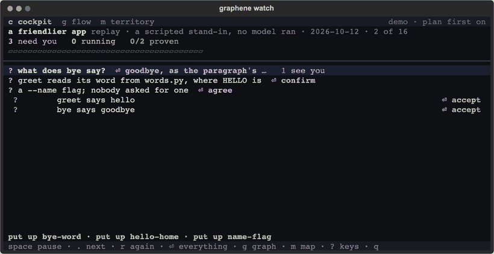
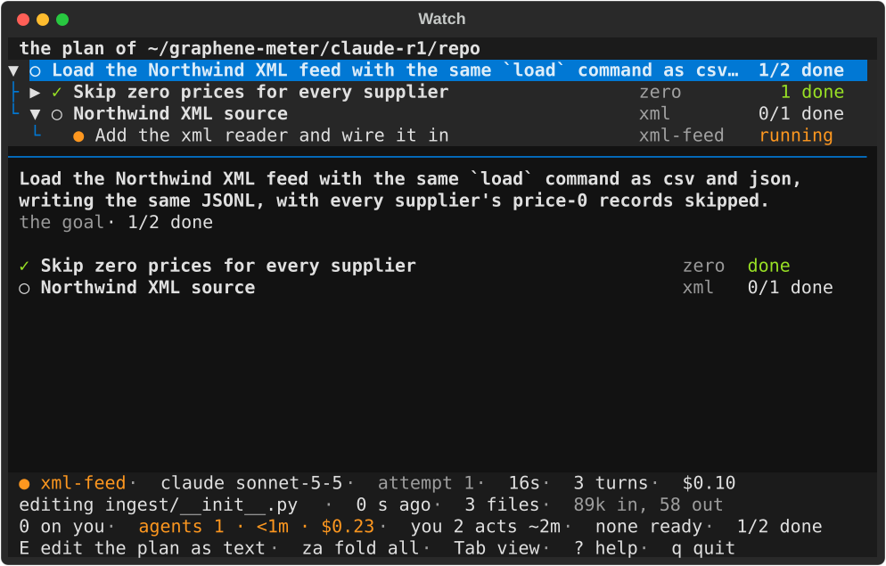

<div align="center">

<picture>
  <source media="(prefers-color-scheme: dark)" srcset="docs/assets/graphene-mark-ivory.svg" />
  
</picture>

# Graphene

See your coding agents' plan and change it before any code.

`uv tool install graphene-map`

<sub>then <code>graphene demo</code> to watch a scripted replay, no API key needed</sub>

<br>



</div>

## Why I built this

I believe that whether it comes from new models, better harnesses or something off the LLM frame entirely, the limit on building software won't be tokens or cost. It'll be the human direction it takes to actually get the software out. I know that sounds a little wild. But no matter how many tokens you have, if you don't say which direction the application should go, the agent has to infer most of it, and you find out what it inferred in the diff, after the time and money are spent. Graphene tries to bridge that: the agent shows you what it understood, as a plan, and you shape it before anything runs.

## What it looks like

A real run on `feeds`, a small test repo I built, is kept whole in [docs/A_RUN.md](docs/A_RUN.md): what the planner said it would leave alone (it was right), the tree it proposed, the two merges, and what the hidden checks said. Honestly, in the three comparisons so far a plain paragraph to the same agent did just as well for less ([the latest](dev/test/results-2026-09-23.md)). What I'm betting on is *when* you find out what it understood: before the work, not after.

## What's different

- It's held by git and the check, not by the agent promising to behave.
- It runs whatever executor you like: Claude Code, Codex, Nemotron, or any command.
- Your history reads like the plan: every leaf lands as its own merge.

## The meter

While the agents work, `graphene watch` shows what each one is doing and what it has spent, and every run ends with one line: the agents' minutes and dollars, next to your own acts. Not claiming it makes the work any better (it just makes it visible), but honestly, the second number is the one I care about.



## Try it on your repo

```
uv tool install graphene-map         # 0.5.0 on PyPI; git+https://github.com/Alex-lop/Graphene for main
cd your-repo && graphene demo        # a replay first: no key, nothing spent
graphene init                        # picks a planner and an executor: claude or codex
graphene ask "what you want, in a paragraph"
graphene watch                       # in another terminal: y accepts, d drops a leaf, R runs what's ready
graphene plan accept && graphene run --parallel 2
graphene node show <a landed leaf>   # what it changed, what its check proved, what it cost
graphene init --remove               # the way out: takes the hooks out of that repo
```

Heads up: `init` installs Claude Code hooks in that repo. They record its sessions on your machine (prompts, tool calls and what they returned, the files it edits), and from your next session Claude proposes a plan before it writes anything; you accept it in `graphene watch`, in another terminal. `graphene plan first off` lets a quick change through at once (bigger work is still proposed), and `graphene init --remove` takes the hooks out.

In `watch`: `y` accepts the plan, `d` drops a leaf you don't want, `R` runs what's ready (it asks first when more than one leaf could start). `?` shows the rest.

## Where it's at

Honestly, it's early, and I'm building it in the open. If you try it on a real repo, what I most want to hear is where the plan misread what you meant, because that's the whole game. Bugs and ideas go in [Issues](https://github.com/Alex-lop/Graphene/issues).

[How it works](docs/HOW_IT_WORKS.md) · [Nemotron on Token Factory](docs/HACKATHON.md) · [my site](https://alex-lop.github.io/Alex_Lopez_Website/) · Apache-2.0
