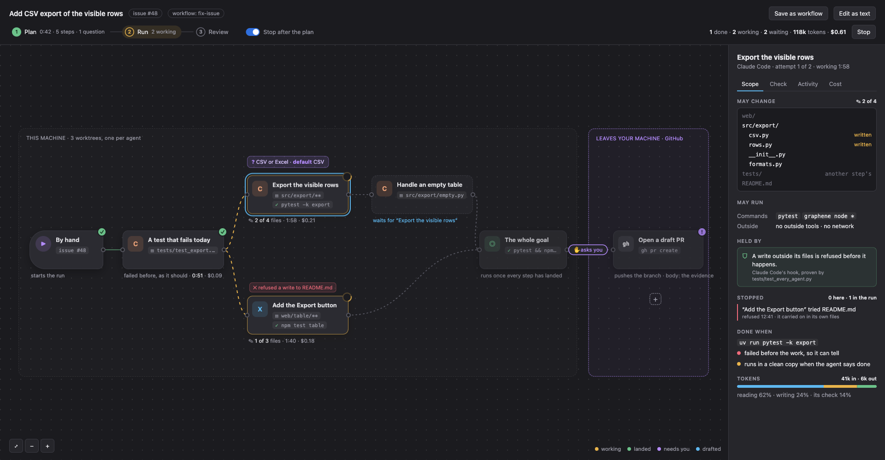

# What Graphene is becoming

Alex, 16 November 2026. This is the direction. The job an agent may take is [SCOPE.md](SCOPE.md),
and the prompt to send is [prompts/workflow.md](prompts/workflow.md). It replaces PRODUCT_NEXT.md
and WORKFLOW_IDEAS.md, whose last copies are at `7c09313f`.

## In one paragraph

Graphene shows you what your coding agents are going to do, and what they are doing, as a graph in
VS Code. Before any code is written, the agent draws its plan, and you watch the branches appear.
You can edit any step, then run it, or let it run on its own. Every step shows its scope: the files
it may change, what it may run, and the check that decides whether its work lands. A graph that
worked can be saved to `workflows/` and run again.

## What it is not

Graphene is not a general automation tool and has no connector catalogue. The n8n market is
crowded. The room left is in **working with agents and understanding them**: a high-level picture
of the work that is true, and fewer tokens wasted on work nobody planned.

From n8n, borrow the **feel**:

- a calm canvas with a clear direction
- a list of runs
- trying one step on its own
- seeing what each step did

## Who it is for

People with some coding background who want a higher-level understanding of their project, and of
what their agents are doing to it. Not people who have never coded, and not a web app.

## Pillar 1: a canvas you watch and shape

**One pipeline, and the plan always comes first.** You have struggled with "plan first, then
accept" versus "auto, then review", and the answer is that they are the same pipeline:
**Plan → Run → Review**. Auto never skips the plan. It just doesn't stop after it.

There is one switch, **Stop after the plan**, and it is on by default. Off is auto: the plan is
still drawn first, then it starts. Questions with no default still stop either way. This follows
what you noticed: a strong plan is what makes agents work out, so the plan is the thing you
look at and edit.

**The plan draws itself.** While the planner writes, each finished step appears as a drafted box
and its edges draw in. Plan text is line by line, so a step can appear as soon as its line is
complete. You can edit a drafted box before the run starts.

**Before Run, the plan is checked:**

- Each step's check runs once on the code as it is.
- A check that already passes is marked: it proves nothing yet.
- Plan faults (overlapping files, a missing check) show on the box they belong to.

**While it runs:**

- Edges carry the work: animated where an agent is working, green where its work landed.
- Writes count up on the box (✎ 2 of 4 files).
- A refused write shows on the box where it happened.
- Any step that hasn't started can still be edited.
- A running step says what an edit would do to it, as the graph already does.

**After:** Review shows each step's evidence, then the whole goal's check, then Approve or Send
back.

**The look.** The target is [ui/canvas.html](ui/canvas.html); open it in a browser, and add
`?still` to see the finished state. Its rules:

- a dotted canvas, with the flow running left to right
- each box is a card: a tile for who does it (Claude, Codex, a command, you), the title, and chips
  for its files and its check
- one line of status under each card, as n8n puts its labels
- curved edges between ports
- colour means state and nothing else: working, landed, needs you, drafted, came back; all of them
  come from VS Code theme tokens, so light, dark and high contrast all work
- a region for **this machine** and one for **leaves your machine**
- motion only where work is happening, and none when the system asks for reduced motion

## Pillar 2: scope you can see

You asked for critique here, and this is my view. **Graphene already has enough guardrails, and
another kind would add clutter.** The gap is that the ones it has are invisible, and written as
globs that only an engineer reads. So show them, at the three moments they matter.

| When | What the person sees |
|---|---|
| Before | Chips on each card for its files and check. Select a card and its pane opens on **Scope**: the file tree with its files lit, other steps' files named, the commands it may run, outside tools (none today), and **held by**. |
| During | Files written against files allowed. A refused write appears on the card that tried it, and the step carries on in its own files. |
| After | Files changed against allowed, and the check's result before and after the work. |

**Held by must be honest.** Each agent is in one of three states, each one proven by
`tests/test_every_agent.py`:

- refused before the write
- caught when it finishes
- not held

Never show a shield for an agent nobody has tested. The editor's own agents (Cursor, Copilot) are
unproven.

**Each step gets one colour**, used on its card and in the Explorer's file marks (`owners.ts`
already marks which task owns each file). You can then see in your own file tree which agent is
where.

**Tokens per step, not a claim.** The meter already reads turns, tokens and cost. Show them on each
step, so a person can see where the tokens go. "Graphene saves tokens" is a claim to measure
later, with the bench in `dev/test/`, before it goes in the README.

**Two things I'd avoid:**

- A glob editor as the main way to set a scope. Use a tree you tick, with the glob behind it.
- New guardrail kinds. Outside tools per step (MCP) come later, when there's a workflow that
  needs them.

## Two kinds of graph

1. **A graph you look at once.** "What would the agent do about this issue?" You plan it, read
   it, edit it, and maybe run it. Use it to understand something, debug, or brainstorm.
2. **A workflow.** A graph saved to `workflows/<name>.md` with inputs, so it can run again on new
   input: fix an issue, review a PR, a nightly job. **Save as workflow** turns any graph into
   one, and the parts that vary become inputs. **Run** on a workflow makes a fresh graph from it,
   with no planner call, so it's cheap and the same each time.

## Local first, and clear about GitHub

Everything runs on your machine. When a step pushes, opens a PR, or later runs on GitHub Actions,
the canvas draws it past the **leaves your machine** line, and crossing that line asks you
first. Triggers on Actions (an issue labeled, a schedule) come after the canvas.

## Your decisions, 16 November

1. A run produces a change to a repo. Understanding what the agents are doing is the point, and
   messages to other apps are a by-product.
2. Both kinds of graph: one-off graphs for understanding, and workflows you run again.
3. The people it is for: those with some background who want a higher-level understanding of
   their projects.
4. Local first. Push and use Actions when it fits, and show it on the diagram.
5. Workflows live in `workflows/` at the repo root.
6. New words are fine when they earn their place. The hackathon is behind us: the README drops
   Nemotron and the hackathon and leads with the workflow canvas.

## The convergence test

Graphene is where it should be when these run from a file, edited on the canvas:

| # | Workflow | What it needs that doesn't exist yet |
|---|---|---|
| 1 | **fix-issue**: issue → failing test → fix → whole-goal check → you approve → draft PR | saved workflows, inputs, a command step, the machine line |
| 2 | **review-loop**: a reader per area → a skeptic per finding → a fixer → check | a step that fans out over a list (`each`), repeat until green |
| 3 | **nightly**: on a schedule → a chore → check → PR if green, issue if red | a trigger on Actions, a branch on the outcome |
| 4 | **your night**: lanes → review → fix → fold → PR → debrief | one workflow calling another |

Each run says which row it moves forward. Work that moves none of them waits.

## Frozen, and cleaned

**Frozen:** the terminal cockpit (`src/graphene_map/cockpit/`), the Nemotron package
(`src/graphene_map/nemotron/`), the demo replay, and the tree, time and DAG views. They keep
working and pass their tests, but they aren't extended. Deleting the Nemotron code is a later
cleanup run of its own.

**The dev docs are three files:** this one, [SCOPE.md](SCOPE.md), and
[prompts/workflow.md](prompts/workflow.md). [DIRECTION.md](DIRECTION.md) remains the decision log,
added to and never rewritten.
