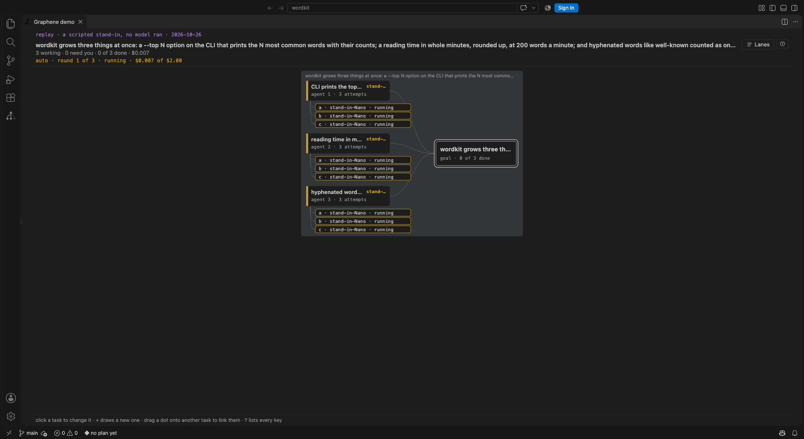
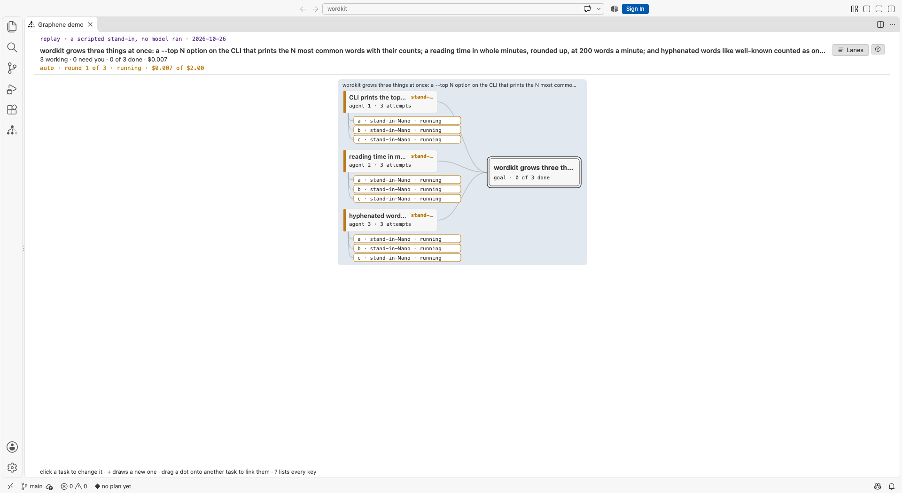
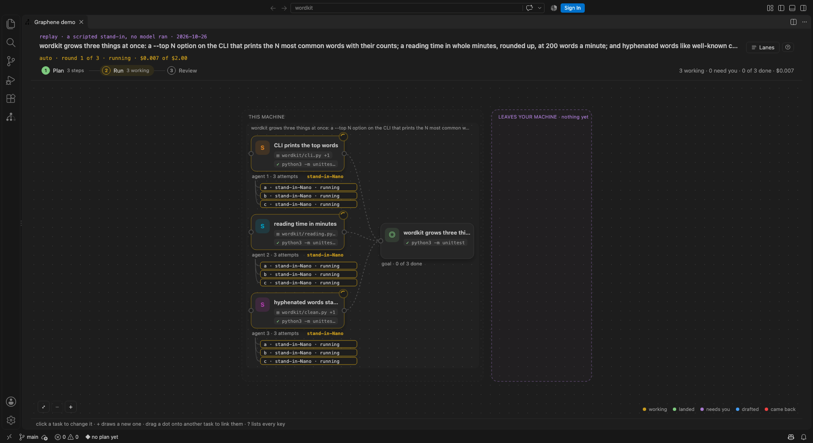
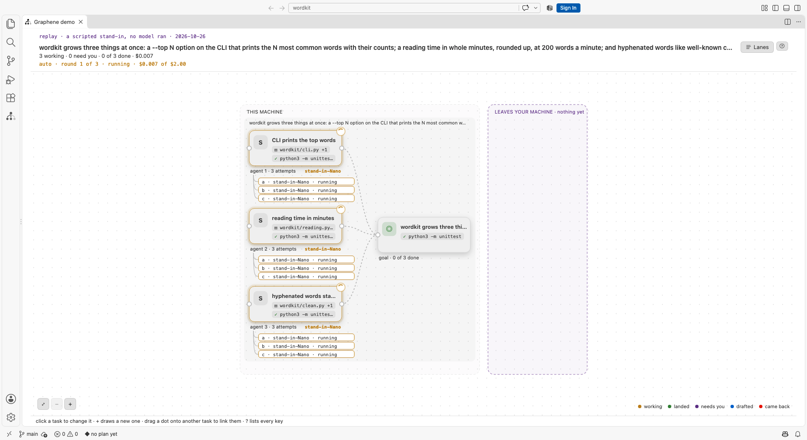

# The canvas run's evidence

The target is [dev/ui/canvas.html](../../ui/canvas.html). The shots here are the VS Code graph before and
after the run restyled it (dev/SCOPE.md, leaf `look`), taken by [shoot.mjs](shoot.mjs): real VS Code,
Graphene: Watch the Demo, 1920x1050, the side bar closed, at the first frame in which three tasks are
working with their nine attempts fanned out. The demo replays a scripted stand-in: no model ran.

| | Dark Modern | Light Modern |
|---|---|---|
| Before |  |  |
| After |  |  |

To take them again:

```sh
cd editors/vscode && npm ci && npm run package && cd e2e && npm ci && cd ../../..
node dev/process/canvas/shoot.mjs after
```

High contrast, the narrow drawing and the other states (a suggested plan, a task that came back, a selected
task) are easiest to look at in the preview page, which needs no editor: `npm --prefix editors/vscode run build`,
then open `editors/vscode/media/preview.html?fixture=race&theme=hc` in a browser (its first lines list the
fixtures and switches).
