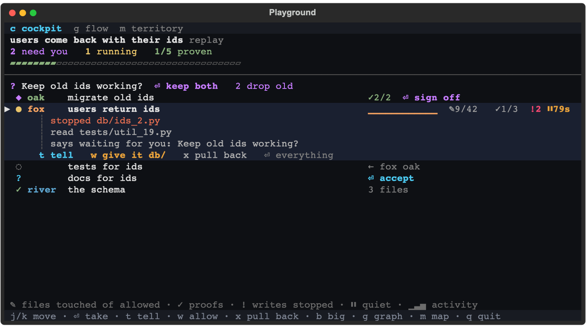
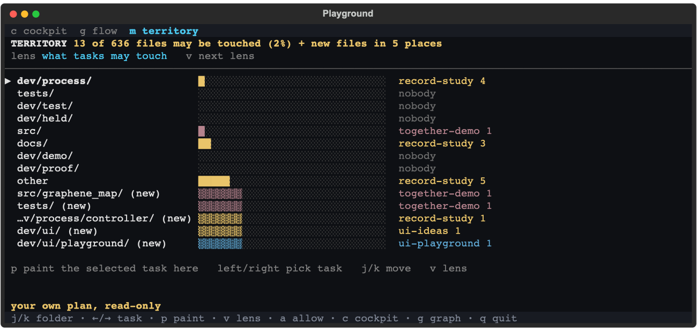
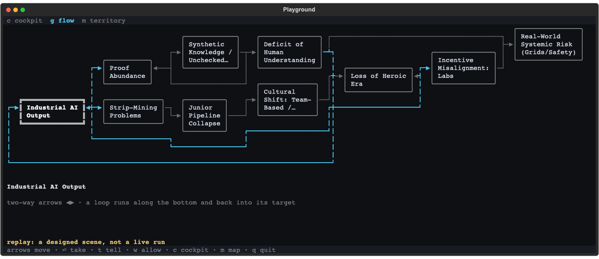

# Graphene, talking to your agents with almost no text

The feel was judged in `dev/ui/playground/` (`uv run python dev/ui/playground/app.py`), which stays a simulator to
try ideas in. What you liked is now `graphene watch` (`src/graphene_map/cockpit/`), on the real plan, with the older
outline behind `--classic`. The shots below are the playground's; the README has the real ones.

## The problem, in one line

"I tell an AI what I want, it fills in the blanks itself, and I only learn which blanks when the work is done."
Graphene asks before (the plan, the board) and checks after. **In between, you watch a gauge you cannot talk
to**, on a screen made for engineers: about 145 words a frame, nine state words, ids and paths.

## What jcode gets right, and what it never does

- It names every agent (fox, oak, river) and gives each a live line: a spinner, `3/9`, "stalled 12s".
- Its own notes call agent chat "the wrong shape" and say "the dependency edge IS the data channel": a graph.
  Its screen never draws that graph, only counters like `nodes 4/9`.
- It never asks you anything: "needs you" is whatever the worker says about itself.

Copy the **feel**, skip the twelve overlapping surfaces. (Read from its code, not run.)

## Three screens, one selection

Move the cursor in one and the others follow.

**1. Cockpit (`c`).** Numbers, not paragraphs: `✎ 9/42` files written of allowed, `✓ 1/3` checks, `⏸ 79s` quiet,
a live tail. On the row: `⏎` its own move, `t` tell, `w` widen, `x` hand back. On 17 October's recording at
80x24 the cockpit showed a median of 56 words a frame (at most 88), the classic screen 98 (at most 135).

**2. Map (`m`).** Which folders each task may write. Only Graphene can show this, because scopes never overlap.
Before you accept: "13 of 636 files may be touched (2%)"; live: touches and stopped writes; after: what changed,
and anything outside. The lens follows the plan's stage.

**3. Graph (`g`).** Your goal at the top, its sub-goals under it, their tasks under those, an agent's number on
its box. Your pasted diagram lays out on its own: 10 nodes, 13 edges, 136 columns.

Limits: busier than your hand-drawn one (terminals want right angles); too wide for the screen, it shows
the selected task's neighbourhood. jcode's prettier diagrams are images, which break in tmux.

## The graph idea, straight

I get it: a graph is the shortest form of direction. There are **two graphs**: *execution* (tasks and what they
wait on; Graphene has it, without loops) and *intent* (what you care about and how it relates; your diagram).
Execution comes first, agents on its boxes: the planner proposes it, you reshape it with single keys. No
free-form editor, no rebuilding LangGraph: our edge is that each box is file-scoped work its check proves, with
you on the loop.

## What is proven, and what is not

**Tell works, mostly.** Real `claude -p` agents (Haiku, half a cent a run) followed a note on their next step in
12 runs of 14 when it came with their next write, and in 1 of 12 when it came as a command ended
(`dev/ui/playground/probe/`; the gate now never tells as a command ends). A cheap
model sometimes ignores a note, so the screen shows "heard" and the live tail, not "done".

## Decided while you slept

You said to do what I think is best. Each flips with one line; the new watch follows all five.

1. **Carry on, and say so.** An unanswered question takes its default, as today; its row shows the default beside
   Enter, and Tell reaches the agent if you change your mind. Stopping an unattended run costs the night.
2. **One window, many agents,** one repository.
3. **Plain words on the new screens** (task, may touch, proof, stuck); the engine and docs keep leaf, scope, check.
4. **Agents go by numbers** (your call, 18 October, over my "keep the names"): agent 1 is on the first task of
   the plan anyone took, a task keeps its number when it is tried again, and "agent 2 is stuck" is sayable.
5. **Execution graph first,** intent graph after.

## Next

Done on 18 October: the graph's sub-goal boxes, from your goal down, and agents by number. Not done: an hour of
real agents on these screens (recordings and throwaway plans only), Tell on Codex, and the intent graph.
