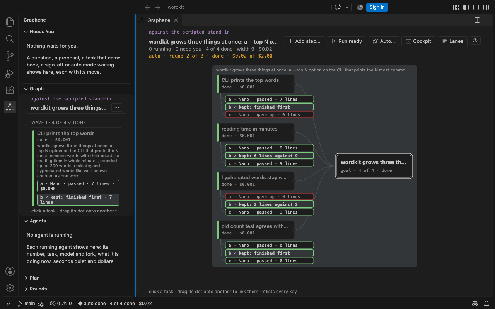

# Graphene for VS Code

Watch and steer a team of coding agents from your editor. Graphene holds each agent to one task, one set of
files and one check. This extension shows what needs you, the agents as they work, and the plan as a graph.



It is a thin client over the `graphene` command. Everything it shows is `graphene state --json`, streamed with
`--watch`, and everything it changes is one `graphene` command, the same ones the terminal cockpit runs.

## What you can do

- **See what needs you first.** Needs You leads the side bar: a question, a proposal, a task that came back, a
  sign-off, your own task, auto mode waiting. Each row has its move inline. Answer a question from its options
  or in your own words, accept or drop a proposal, take up a hand-back, sign off from the diff, set a missing
  key. Nothing sends you to the terminal.
- **Watch the agents.** Agents lists every running agent: its number, task, model and fork, what it is editing
  now, seconds quiet and dollars. Click one for its changes so far.
- **Open any change in the diff editor.** A task or a fork opens against its base in VS Code's own diff editor.
  A race's forks open side by side, and Keep This Fork and Sign Off sit in the diff's title.
- **Read the race in the graph.** Tasks flow left to right into your goal. A forked task fans out into its forks
  with their lines, dollars and seconds quiet, and the kept one says why it won. A task that came back is red,
  with why. Narrow, the side bar draws the plan as lanes, wave by wave. Nothing is drawn under 11 px.
- **Edit the plan as text.** Edit Plan as Text opens the plan's text form in an editor tab. Saving applies it,
  all or none, and a refusal shows as a diagnostic on its line.
- **Add a step in a sentence.** Type one line. The planner proposes the step with its scope, check and needs,
  and it waits for your accept. Add Step by Hand keeps the four boxes.
- **See whose file this is.** The Explorer marks each file a task owns, a running task's with its agent's
  number. Open such a file and the status bar offers a diff with the agent's copy.
- **Try it with no key.** Graphene: Watch the Demo plays a scripted run in a graph of its own, with no model
  and no network, and its header says so.

## Install

1. Graphene itself, once, in a terminal (it needs Python 3.12 or later and [uv](https://docs.astral.sh/uv/)):

   ```sh
   uv tool install graphene-map
   ```

   The extension offers to run this for you when it cannot find `graphene`. It looks on the PATH, in
   `~/.local/bin` and in uv's tool directory first.

2. This extension, from the `.vsix` on [the latest release](https://github.com/Alex-lop/Graphene/releases/latest),
   or from the Marketplace (VS Code) and Open VSX (Cursor) once it is published there:

   ```sh
   code --install-extension graphene-0.8.0.vsix      # Cursor: cursor --install-extension graphene-0.8.0.vsix
   ```

3. Open a folder. `Graphene: Set Up This Folder` asks who plans and who does the work, in two picks: Nemotron on
   Token Factory, Claude Code, Codex, or a command of your own. It runs `graphene init` in a terminal. Then
   `Graphene: Auto…` takes a goal and a budget, and plans first.

The Welcome page's **Get started with Graphene** walks through these, each step a button.

## Editors

VS Code 1.95 or later. In Cursor 3.25.6 (VS Code 1.128) the `.vsix` installs and activates, and the harness's
end-to-end check passes there (`editors/vscode/e2e`). Cursor's agent layout hides the primary side bar; in its
classic layout the views look as they do in VS Code.

## Views

- **Needs You**: questions, proposals, hand-backs, sign-offs, your own tasks and auto mode waiting, each with
  its move inline, and a badge with the count.
- **Graph**: the plan as a graph, in the side bar and as an editor tab (`Graphene: Show Plan Graph`); `?` lists
  its keys.
- **Agents**: every running agent, what it is doing, seconds quiet and dollars, and a badge with the count.
- **Plan**: goal, sub-goals and tasks with a codicon per state and `model · forks · $` beside each.
- **Rounds**: auto mode's iterations, what the envelope accepted, which fork each task kept and what landed.
- **Explorer** marks and a **status bar** item: `◆ 2 running · 1 needs you · $0.42`; click it for the graph.

## Commands

All under `Graphene:` in the command palette; most are also in the views' menus and the graph's details pane.

| Command | What it does |
| --- | --- |
| Auto… | a goal, a budget and whether to plan first: `graphene auto "<goal>"` in a terminal you can stop |
| Set Envelope… | what auto mode may do without you: budget, tasks, rounds, forks, checks |
| Run Ready Tasks / Stop | `graphene run --parallel 4` in a terminal; `graphene run --stop` |
| Answer… | a board question: its options, its default, or your own words |
| Accept / Accept All | a proposal, or all of them |
| Take Up the Hand-Back… | a task that came back: widen it, reopen its owner, or try again |
| Sign Off | a task waiting on you, from its diff |
| Mark Your Task Done | a task of your own: `graphene node done` in a terminal, where its check runs |
| Set Key… | `graphene key set` in a terminal, a hidden prompt; offered when a run waits on a key |
| Open Changes / Compare Forks / Keep This Fork | a task or fork in the diff editor; a race side by side; the one to keep |
| Edit Plan as Text | the plan's text form in an editor tab; save applies it |
| Add Step… | one sentence; the planner proposes the step |
| Add Step by Hand… | title, where, scope and check, typed |
| Link… / Edit Step… / Drop Step | B waits on A; title, scope or check; drop it (`graphene plan undo` puts it back) |
| Tell Agent… | one line a hooked agent reads before its next write |
| Diff with the Agent's Copy | the open file against the running agent's version |
| Watch the Demo | a scripted run in a graph of its own, no key and no network |
| Show Plan Graph / Open Cockpit | the graph as a tab; `graphene watch` in a terminal |
| Set Up This Folder / Install Graphene… / Refresh | `graphene init`; `uv tool install graphene-map`, after you say yes; read the plan again |

## Settings

| Setting | Default | What it does |
| --- | --- | --- |
| `graphene.path` | `graphene` | the command: a name on PATH or an absolute path. Read from your own settings only, never a folder's |
| `graphene.pollMs` | `1500` | how often the plan is read again while a view is open, when the CLI has no `--watch` stream |

## Trust and privacy

- **A thin client.** The extension reads the plan with `graphene state --json` and changes it with `graphene`
  commands, run as you in the folder. It never opens the plan's store itself.
- **No network of its own.** The extension makes no request and sends no telemetry. The models you configured
  (Token Factory, Claude Code, Codex) are the CLI's business, in a terminal you can see, with a key it reads from
  a hidden prompt.
- **Off in Restricted Mode.** In a folder you have not trusted it does nothing: it would run commands, and the
  plan's checks, there.
- **Your settings only.** `graphene.path` comes from your user settings, never from a folder's
  `.vscode/settings.json`, so a cloned repository cannot choose what the extension runs.
- **A click in VS Code is the person's.** An editor started from an agent's shell inherits the agent's marks
  (`CLAUDECODE`, `CODEX_SESSION_ID`, …); the extension takes them out of everything it runs, so your accept
  is a person's.
- **The demo stays out of your folder.** Watch the Demo plays into a directory under the OS temp dir, and
  closing its graph removes it.

## Limits

- It needs Graphene 0.9 or later for the Agents view, the diffs, the text plan and the demo; with an older CLI
  each view says what the CLI said, and the plan is polled instead of streamed.
- One plan per window: the first workspace folder with a store.
- Nobody has used it on a real run yet. It was built and checked against a fixture and a scripted stand-in.

Source, issues and the CLI: [github.com/Alex-lop/Graphene](https://github.com/Alex-lop/Graphene). Licence
Apache-2.0.
